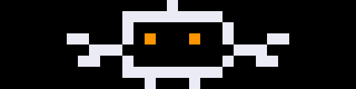

# claude-pixel-bot

A little robot that **waves from your desk when Claude Code needs you** — a
permission prompt, an idle prompt, or an agent waiting on input — then drops
its arm and hands the screen back to the clock when the turn ends.

It runs on a **Ulanzi TC001** (32×8 pixel clock) flashed with
[AWTRIX 3](https://github.com/Blueforcer/awtrix3), driven by
[Claude Code hooks](https://code.claude.com/docs/en/hooks).



*Preview shown at 16× actual size. The character is derived from
[`assets/robot-v2.png`](assets/robot-v2.png).*

---

## How it works

- **`Notification`** hook (matching `permission_prompt|idle_prompt|agent_needs_input`)
  → runs `pixel-bot.sh attention`, which starts the wave.
- **`Stop`** hook (fires at the end of every turn) → runs `pixel-bot.sh clear`,
  which stops the wave and returns the screen to the clock.

The robot is the **full 32×8 screen**, so it can't be a device-side GIF —
AWTRIX only animates GIFs in an 8×8 icon slot. Instead the animation is
**host-driven**: a small detached Python loop streams the 16 frames to the
device over HTTP (`POST /api/notify` with `draw` pixel commands) at ~6 fps
until told to stop. It's a LAN request loop — sub-second and self-healing:
if the player dies, each frame's `duration` lapses and the clock comes back
on its own.

```
Claude Code event ──> pixel-bot.sh ──> pixel_bot.py ──HTTP──> Ulanzi TC001
   Notification            attention        play loop            waves
   Stop                    clear            SIGTERM + dismiss     clock returns
```

## Layout

| Path | What it is |
| --- | --- |
| `pixel_bot.py` | Runtime player. **Stdlib only** — no pip installs, no venv. |
| `frames.json` | The baked 16-frame animation the player streams. |
| `hooks/pixel-bot.sh` | Hook wrapper. Always exits 0 (see the gotcha below). |
| `settings-snippet.json` | The `hooks` block to merge into `~/.claude/settings.json`. |
| `tools/generate_frames.py` | Rebuilds `frames.json` + the preview GIF. Needs Pillow. |
| `assets/robot-v2.*` | The original pixel-art reference. |
| `preview/robot-wave.gif` | The animation preview above. |

## Prototype in the browser (no hardware)

`tools/mock_awtrix.py` is a browser stand-in for the TC001: it implements the
same AWTRIX HTTP endpoints and renders a 32×8 LED matrix as a web page.
`pixel_bot.py` drives it **unchanged** — the only thing hardware changes is
`AWTRIX_IP`.

```bash
# terminal 1 — start the simulator, then open http://localhost:7777
python3 tools/mock_awtrix.py

# terminal 2 — drive it exactly like the hooks will
AWTRIX_IP=localhost:7777 python3 pixel_bot.py test        # wave for ~4s
AWTRIX_IP=localhost:7777 python3 pixel_bot.py attention   # start waving
AWTRIX_IP=localhost:7777 python3 pixel_bot.py clear       # back to the clock
```

You can even wire your live Claude Code hooks to the simulator: set
`AWTRIX_IP=localhost:7777` in `hooks/pixel-bot.sh` and watch the browser react
to real permission/idle notifications before the device ever arrives.

## Setup

Assumes a TC001 already flashed with AWTRIX 3 and joined to your Wi-Fi, with a
**DHCP reservation** for its IP (otherwise the lease rotates and the notifier
silently dies weeks later).

```bash
# 1. Put the bot where the hook expects it
git clone https://github.com/ewoolery/claude-pixel-bot.git ~/.claude/pixel-bot

# 2. Install the hook wrapper
mkdir -p ~/.claude/hooks
ln -sf ~/.claude/pixel-bot/hooks/pixel-bot.sh ~/.claude/hooks/pixel-bot.sh
chmod +x ~/.claude/hooks/pixel-bot.sh

# 3. Tell it your device IP (edit the file, or export the vars)
#    In hooks/pixel-bot.sh: set AWTRIX_IP and PIXEL_BOT_DIR.
export AWTRIX_IP=192.168.1.50
export PIXEL_BOT_DIR=~/.claude/pixel-bot

# 4. Smoke test — should ping the device and wave for ~4s
AWTRIX_IP=$AWTRIX_IP python3 ~/.claude/pixel-bot/pixel_bot.py test
```

Then merge the `hooks` block from [`settings-snippet.json`](settings-snippet.json)
into `~/.claude/settings.json` (don't overwrite the file — add the key), and
confirm both events registered with `/hooks` inside Claude Code.

**End-to-end check:** ask Claude to run a command it needs approval for and
watch the robot wave; it should drop its arm when the turn ends.

## Configuration

All via environment variables (read by `pixel_bot.py`):

| Var | Default | Meaning |
| --- | --- | --- |
| `AWTRIX_IP` | `192.168.1.50` | Device IP. **Set this.** |
| `PIXEL_BOT_TIMEOUT` | `2` | Per-request timeout, seconds. |
| `PIXEL_BOT_PIDFILE` | `/tmp/claude-pixel-bot.pid` | Tracks the player process. |
| `PIXEL_BOT_FRAMES` | `frames.json` beside the script | Animation to play. |
| `PIXEL_BOT_DIR` | `$HOME/.claude/pixel-bot` | Checkout location (used by the wrapper). |

## Changing the character

Edit `tools/generate_frames.py`, then regenerate both the frames and the
preview:

```bash
pip install Pillow
python3 tools/generate_frames.py
```

The palette, the static body, and the four right-arm wave poses are all near
the top of that file.

## The critical gotcha

`hooks/pixel-bot.sh` **always exits 0.** On Claude Code's `Stop` event, exit
code 2 tells Claude *not* to stop and to continue the conversation — so a
propagated failure from an unreachable display could keep a session alive
indefinitely. The wrapper swallows all errors and exits 0 by design. Don't
"fix" that.

## Known limitations

- **State is global to the display, not per-session.** Two concurrent Claude
  Code sessions will fight — one finishing clears the wave the other started.
- **Claude Code only.** The Claude desktop/web apps have no hook system.
